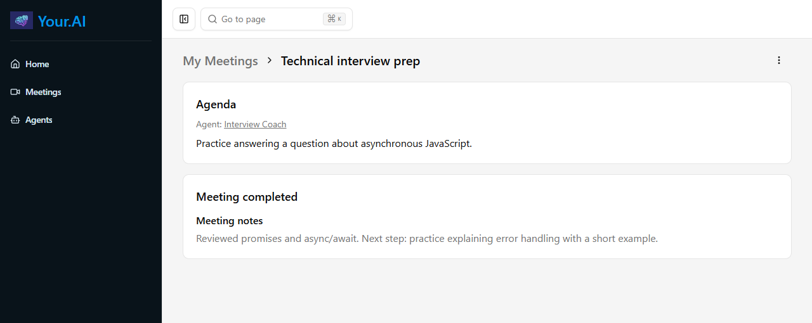

# Your AI

Your AI is a meeting workspace for creating a specialist assistant, preparing an agenda, and keeping a record of decisions. The core demo runs locally without a cloud database or API keys.

[Open the hosted app](https://your-ai-okannaci.vercel.app/) to sign up and use the original Your AI workspace. See below for local setup and optional AI or video integrations.



## What you can do

- Create an account with email and password.
- Create, edit, and search agents with your own role instructions.
- Assign an agent to a meeting, set an agenda, and start, cancel, or finish the meeting.
- Save meeting notes and find past meetings by name, status, or agent.
- Add an OpenAI API key to ask an agent a text question in its playground.
- Add Stream credentials to open a video room from an active meeting.

## Run locally

You need Node.js 22 LTS or newer, npm, and Git.

```sh
git clone https://github.com/OkanNaci/your-ai.git
cd your-ai
npm ci
npm run setup
npm run dev
```

Open [http://localhost:3000](http://localhost:3000) and choose **Sign up**. Setup creates a local authentication secret in `.env.local` if that file does not exist, then applies the database schema. By default, the embedded PostgreSQL database lives in `.data/postgres` and persists between restarts. If you already have a `.env.local`, make sure it contains a valid `BETTER_AUTH_SECRET` and the correct `BETTER_AUTH_URL`.

## 60-second demo

1. Open **Agents → New Agent**. Name it **Interview Coach** and give it this role: “Coach junior developers for JavaScript interviews. Give one concrete example with each answer.”
2. Open **Meetings → New Meeting**. Name it **Technical interview prep**, select **Interview Coach**, and add an agenda: “Practice answering a question about asynchronous JavaScript.”
3. Choose **Start meeting**, write a decision or next step under **Meeting notes**, then choose **Finish meeting**.
4. Reload the page to show that the notes were saved. Return to **Meetings** and filter by **Completed**.

If OpenAI is configured, open **Interview Coach** and ask “How would you explain async/await in an interview?” to show how the saved instructions shape the answer.

## Optional services

Set the relevant variables in `.env.local` using [`.env.example`](.env.example) as a reference. Restart the dev server after changes.

| Service | Variables | What it enables |
| --- | --- | --- |
| OpenAI | `OPENAI_API_KEY`, optional `OPENAI_MODEL` (defaults to `gpt-5-mini`) | Text replies in the agent playground. Each question is independent. |
| Stream Video | `NEXT_PUBLIC_STREAM_VIDEO_API_KEY`, `STREAM_VIDEO_SECRET_KEY` | Camera and microphone preview and an owner-only video room for active meetings. |
| Neon | `DATABASE_URL` | Hosted PostgreSQL as an alternative to the embedded database. Apply the schema with `npm run db:push` against a development database. |
| Google or GitHub | The matching `*_CLIENT_ID` and `*_CLIENT_SECRET` | Optional social sign-in. Register `<BETTER_AUTH_URL>/api/auth/callback/google` or `/api/auth/callback/github` with the provider. |

The meeting workflow uses manual notes. Agents answer in the text playground. Voice participants, automatic transcription and summaries, and guest invitations are outside this version’s scope.

## How it fits together

- **Next.js, React, Tailwind CSS** render the dashboard, forms, and meeting views.
- **Better Auth** manages accounts and sessions.
- **tRPC and TanStack Query** connect the UI to server procedures and refresh data after edits.
- **Drizzle with PGlite or Neon** stores accounts, agents, meetings, and notes. Server procedures scope records to the signed-in account and enforce valid meeting state transitions.

```sh
npm run lint
npm run typecheck
npm run build
```

To exercise the core meeting workflow in Chromium, run `npx playwright-core install chromium` and `npm run test:smoke` after installing dependencies. Alternatively, set `CHROMIUM_PATH` to an installed Chromium or Chrome executable. Run with `DATABASE_URL` and `BETTER_AUTH_URL` unset. The test creates a temporary local application and PGlite database, then saves desktop and mobile screenshots under `.next/smoke-artifacts/`.

Set `YOUR_AI_TEST_OPENAI=1` when running the smoke test to exercise the saved agent instructions, edits, and retry behavior with a local OpenAI fixture. The deployed integration requires a server-side `OPENAI_API_KEY`.
